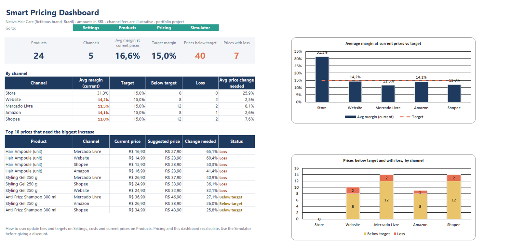
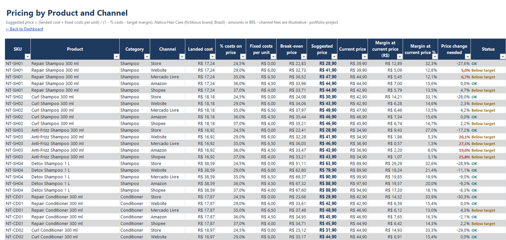
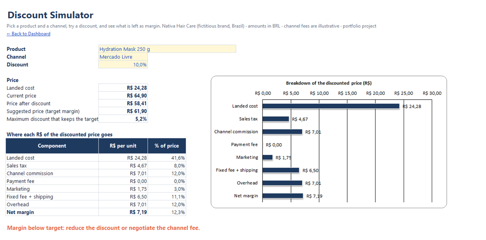
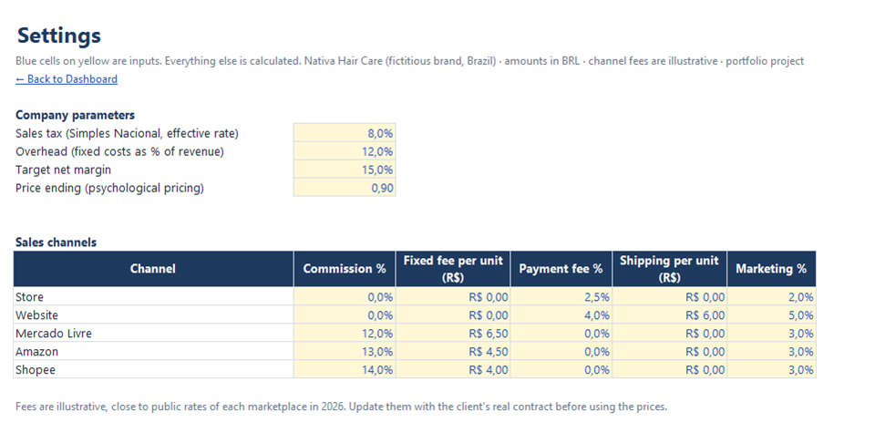
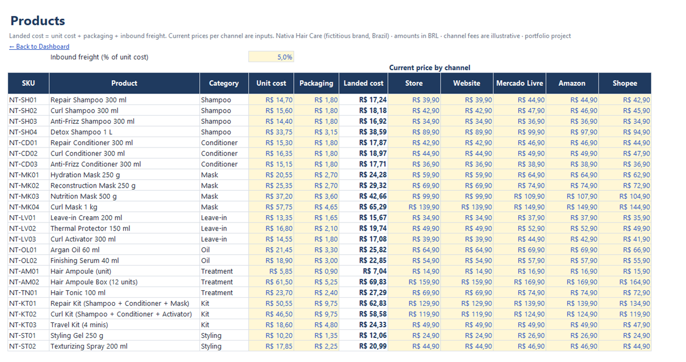

# Smart Pricing Spreadsheet for Multichannel Sales (Excel)

> Status: complete · Portfolio project with fictitious data

## Business problem
A small cosmetics brand sells the same products in its own store, its website and three marketplaces
(Mercado Livre, Amazon, Shopee). Each channel takes a different commission, fixed fee, payment fee and
shipping cost, so a price that is healthy in the store can lose money on a marketplace. The owner needs to
know, for every product and channel: the minimum price, the price that reaches the target margin, the margin
at today's price, and how much discount a promotion can afford.

The brand is **Nativa Hair Care**, a made-up Brazilian hair care brand with 24 products and 5 channels
(120 prices). Amounts in BRL; channel fees are illustrative.

## What the workbook does
| Sheet | What it answers |
|---|---|
| Dashboard | Average margin by channel vs target, how many prices are below target or losing money, and the 10 prices that most need an increase |
| Settings | Inputs: sales tax (Simples Nacional effective rate), overhead, target margin, price ending, and each channel's commission, fixed fee, payment fee, shipping and marketing |
| Products | Inputs: unit cost, packaging, inbound freight and today's price in each channel; landed cost per product |
| Pricing | One row per product and channel: break-even price, suggested price, margin at the current price, price change needed and status (OK / Below target / Loss) |
| Simulator | Pick a product, a channel and a discount: where each R$ of the price goes, the margin left, and the maximum discount that keeps the target margin |

| | |
|---|---|
|  |  |
|  |  |

## Pricing logic
For each product and channel:

- **% costs on price** = sales tax + overhead + commission + payment fee + marketing
- **Fixed costs per unit** = channel fixed fee + shipping subsidy
- **Break-even price** = (landed cost + fixed costs) / (1 - % costs)
- **Suggested price** = (landed cost + fixed costs) / (1 - % costs - target margin), rounded up to end in ,90
- **Margin at current price** = price × (1 - % costs) - landed cost - fixed costs
- **Maximum discount** = 1 - (landed cost + fixed costs) / (price × (1 - % costs - target margin))

What the fictitious data shows: the store runs at a 31% margin, but the marketplaces sit at 11-14%, below the
15% target; 40 of the 120 prices are below target and 7 lose money, mostly cheap items where the marketplace's
fixed fee per order eats the margin (a single hair ampoule at R$ 16,90 on Mercado Livre needs R$ 27,90).

## Excel features
- Named ranges for every parameter (`TaxRate`, `Overhead`, `TargetMargin`, `ChannelList`...), so formulas read
  like the business rule
- INDEX/MATCH lookups (works in Excel 2016 and later, no dynamic arrays needed), an Excel table with filters on
  Pricing, and a tie-safe ranking for the Top 10 list
- Data validation drop-downs on the Simulator, conditional formatting for status and margins
- Input cells in blue on yellow, formulas in black (financial modeling convention); navigation links between sheets

## How to run
Open `SmartPricing.xlsx`. The first version was generated by `scripts/build_workbook.py` (openpyxl) and then
refined by hand in Excel, so the `.xlsx` file is the source of truth.

## Tools
Excel (formulas, named ranges, tables, data validation, conditional formatting, charts), Python (openpyxl) to
generate the workbook.
